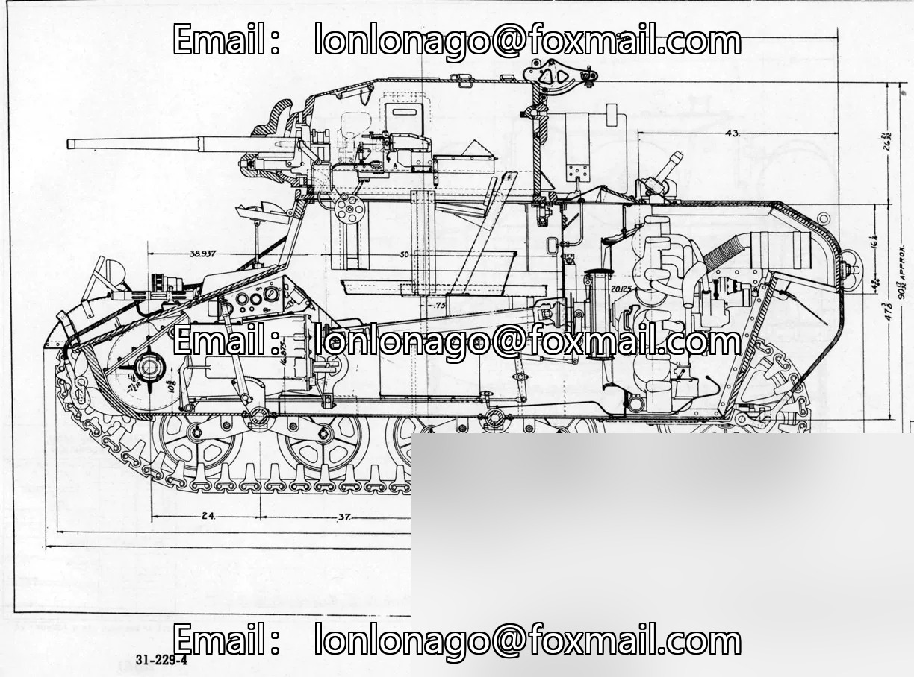
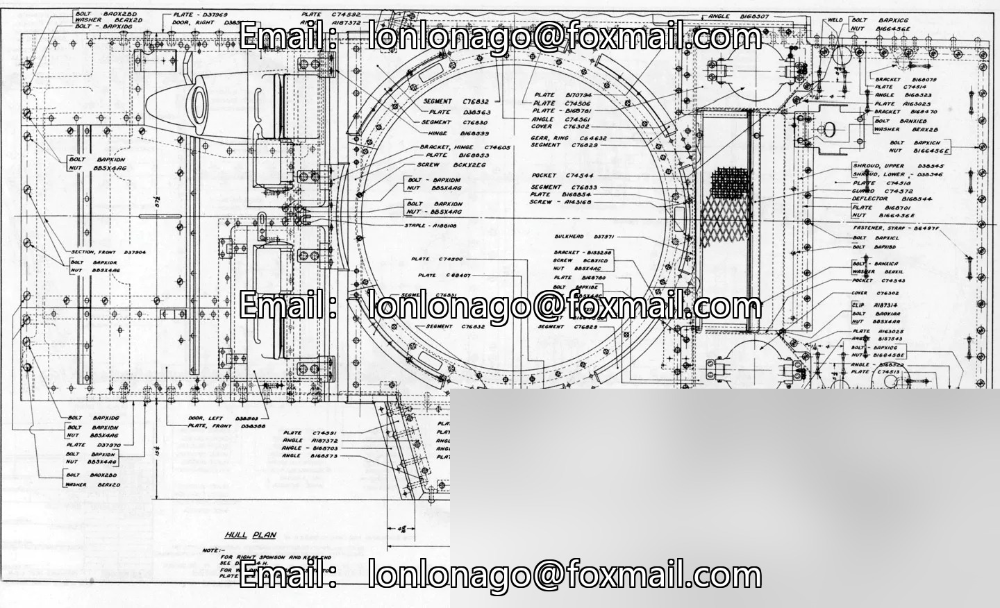
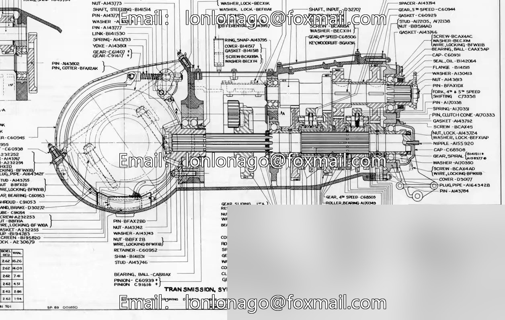
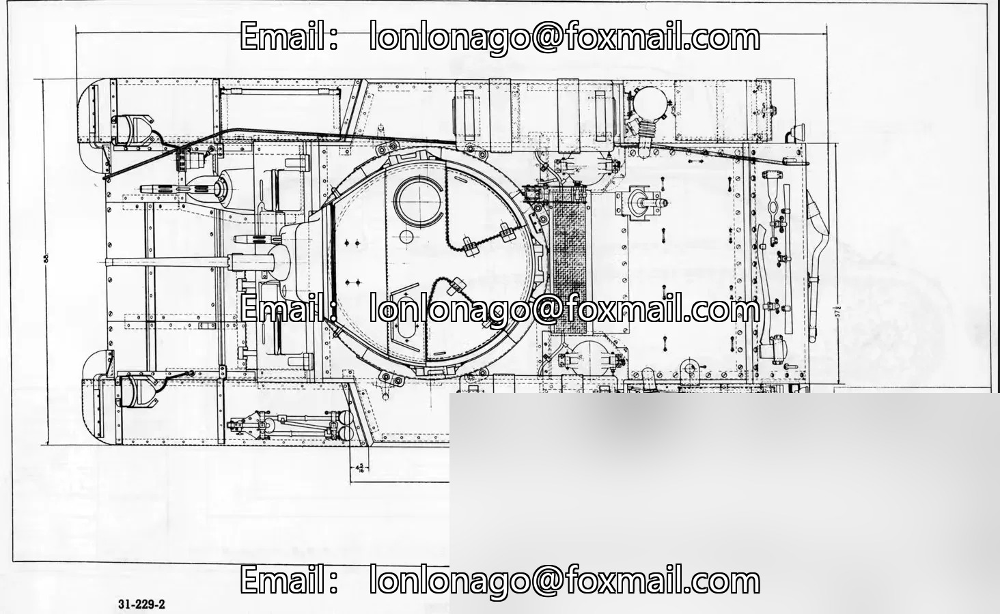

# During World War II, the U.S. Army Ordnance Department (Ordnance Dept, U.S.)

## Body

Official engineering drawings of the United States Army Ordnance Dept (USA) regarding the **M3 and M3A1 "Stuart" Light Tank (Tank, Light, M3/M3A1)**.
Due to the M3A1 being replaced by more advanced M5 series in mid-1942, these drawings record the final design status of the model during its peak service.
Factory drawings of the M3, M3A1 Stuart tanks (1935-1942).
70 pages
Resolution approximately 3808*2424

These are official engineering drawings for the U.S. Army Ordnance Department's M3 and M3A1 "Stuart" light tanks from World War II, covering factory drawings, dimensions and material details.

<!-- AI_ENRICHED -->

## Images

## Payment

Here is a pay link on Stripe ( https://buy.stripe.com/3cs8yP7sY87d0vu9AB ). Please contact me lonlonago@foxmail.com after funding $89, and I will send you a complete data files , thank you!

